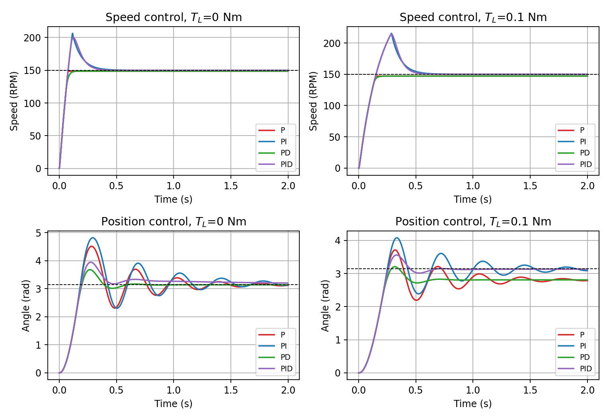
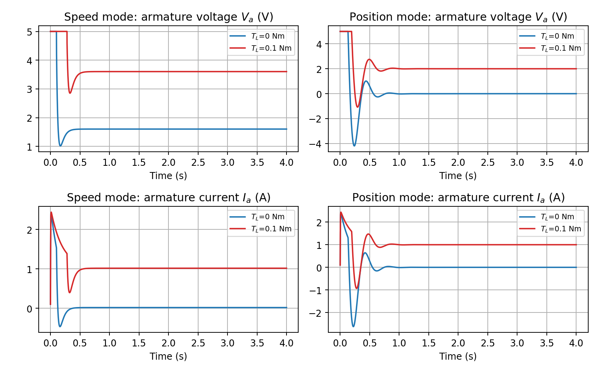

# DC Motor Closed-Loop Speed & Position Control Simulator

An interactive desktop app for exploring P, PI, PD and PID control of a DC motor. Pick a mode, pick a controller, drag the sliders, and the plots update as you go. It is meant for building intuition about what each control term does, why steady-state error shows up, and how a load torque changes things.



## Features

- **Two control modes**
  - *Speed control*: the input voltage `Vin` (0-5 V) sets a target speed of 0-300 RPM.
  - *Position control*: `Vin` sets a target shaft angle of 0-2π rad.
- **Four controller types**: P, PI, PD, PID.
- **Live tuning**: sliders for `Kp`, `Ki`, `Kd`, armature inductance `La`, load torque `TL`, simulation time and `Vin`.
- **Load torque disturbance**: apply a constant torque and watch the error, voltage and current change.
- **Realistic driver limit**: the controller output is clipped to ±5 V, like an H-bridge supply, so you can see saturation and integrator wind-up.
- **Four plots at once**: target vs. actual response, armature voltage, armature current, and the other shaft variable (angle in speed mode, speed in position mode).

## Requirements

- Python 3.8+
- `numpy`
- `matplotlib`
- `tkinter` (ships with most Python installs)

```bash
pip install numpy matplotlib
```

On some Linux distributions Tkinter is a separate package:

```bash
sudo apt install python3-tk
```

## Running it

```bash
python main.py
```

The app opens in Position mode with a PID controller and its default gains.

## Using the app

| Control | What it does |
|---|---|
| Control Mode | Switch between Speed and Position control. Switching also loads that mode's default gains. |
| Controller Architecture | Choose P, PI, PD or PID. Unused gains are ignored (e.g. `Ki` and `Kd` do nothing in P mode). |
| Input Vin | Sets the target: up to 300 RPM in Speed mode, up to 2π rad in Position mode. |
| Armature Inductance (La) | 0.0001-0.05 H. |
| Load Torque (TL) | 0-0.2 Nm, applied as a constant from the start. |
| Simulation Time | 0.5-10 s. |
| Kp / Ki / Kd | Controller gains. Ranges are 0-50, 0-200 and 0-2. |
| Reset / Update Simulation | Re-runs the simulation with the current settings. |

Default gains:

| Mode | Kp | Ki | Kd |
|---|---|---|---|
| Position | 6.0 | 4.0 | 0.2 |
| Speed | 1.2 | 15.0 | 0.02 |

The units of `Kp` depend on the mode: V/rad in Position mode and V/RPM in Speed mode, because the error is measured in rad or RPM respectively.

## How it works

### Motor model

The motor is an armature-controlled DC motor:

```
La * dIa/dt = Va - Ra*Ia - Kb*ω
J  * dω/dt  = Kt*Ia - B*ω - TL
dθ/dt       = ω
```

| Parameter | Value | Meaning |
|---|---|---|
| Ra | 2.0 Ω | Armature resistance |
| Kt | 0.1 Nm/A | Torque constant |
| Kb | 0.1 V/(rad/s) | Back-EMF constant |
| J | 0.001 kg·m² | Rotor inertia |
| B | 0.0001 Nm·s/rad | Viscous friction |

`La` and `TL` are set from the sliders. The model is simulated in the time domain with a fixed step of 0.1 ms.

### Controller

```
e  = r - y
u  = Kp*e + Ki*∫e dt + Kd*de/dt
Va = clip(u, -5 V, +5 V)
```

`r` is the target and `y` is the measured speed (RPM) or angle (rad). `Vin` is only a command that gets scaled into the target (60 RPM per volt in Speed mode, 2π/5 rad per volt in Position mode). The motor itself receives `Va` from the controller.

### Block diagram

```
Vin -> [scaling] -> r --> (+)(-) -> [ PID ] -> [ ±5 V limit ] -> [ DC motor ] --> (-)(+) --> y
                          ^                                                       ^         |
                          |                                                       |         |
                          |                                                  load torque TL |
                          +-------------------------------------------------------------- feedback
```

## What to try

- **P only:** the response is quick but settles short of the target. Raise `Kp` and the gap shrinks but never closes.
- **Add I:** the steady-state error goes to zero, but the overshoot grows, partly because the integrator keeps charging while the output sits at the 5 V limit.
- **Add D:** overshoot drops, especially in Position mode. The final error does not change.
- **Apply a load torque:** look at the armature current and voltage plots. They now settle at non-zero values because the motor has to fight the load all the time. P and PD develop (or increase) a steady-state error, while PI and PID still reach zero.
- **Position vs. Speed with P:** at no load, position control settles at the target while speed control does not. At the target the shaft is at rest, so no voltage is needed to hold it, but a spinning motor needs voltage to overcome its own back-EMF.



## Steady-state error summary

| Controller | Speed mode | Position mode |
|---|---|---|
| P, PD | Small error at no load, larger with load | Zero at no load, non-zero with load |
| PI, PID | Zero | Zero |

This holds as long as the voltage the motor needs stays inside the ±5 V limit. If it doesn't (for example, high speed with a heavy load), no controller can reach the target.

## Simplifications

- Motor parameters are constant and friction is purely viscous.
- The load torque is constant.
- Sensors are noise-free and there is no delay.
- The derivative term acts directly on the error with no filtering, and the integrator has no anti-windup, so both behave the way a plain textbook PID does.
- The simulation runs in a plain Python loop, so very long runs (10 s is 100,000 steps) can feel a bit slower while dragging sliders.

## Project layout

```
.
├── main.py          # the whole app (GUI, controller and motor model)
├── images/
│   ├── fig_compare.png
│   └── fig_baseline.png
└── README.md
```
